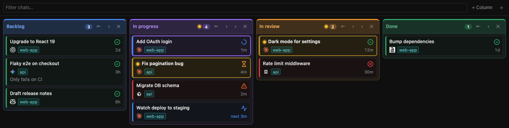
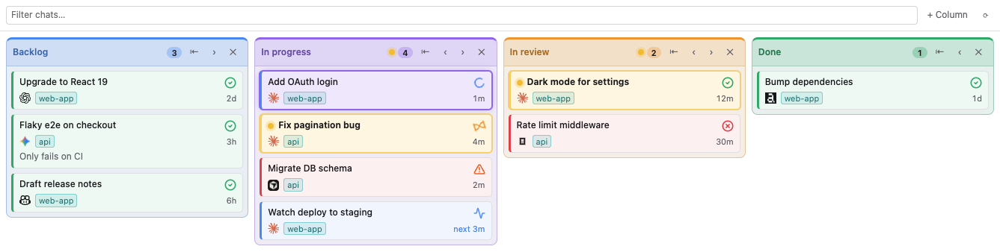

# Chat Board for Orca

A kanban of your **agent chats**: the Claude, Codex, Cursor, Gemini and other agent tabs you have open, terminal or chat, across every Orca workspace. Orca's Workspace Board groups work by workspace. Chat Board groups it by conversation, which helps when you keep many chats on different topics open in the same workspace.



## Install

```sh
orca plugin install SantiagoCaprile/orca-chat-board
```

Orca lists the access the plugin asks for (see [Permissions](#permissions)) and asks you to approve it. Then open **Chat Board** from the right sidebar's activity bar.

## What it does

**Board**
- Every tab that runs an agent gets a card: terminal tabs, and Orca's chat tabs once they have a conversation. New chats land in the first column.
- Make your own columns: add, rename (double-click the title), reorder (‹ ›), collapse into a narrow strip (⇤) and delete.
- Drag cards between columns and within a column.
- Filter by title, note, workspace or agent.

**Live status**
- Each card shows the agent's status as an icon: working (spinner), waiting for you (hourglass), done (check), interrupted (red cross), needs permission (alert).
- **Not seen yet:** when an agent stops working while you are looking at another chat, its card turns yellow with a dot, like Orca's unread tab. Its column header gets a dot too. The mark clears when you open the chat or when the agent starts working again.
- **Open chat:** the chat you have open in Orca gets a ring in its column's colour.
- **Monitoring:** loops and watchers get Orca's pulse icon and their next run ("next 3m"). That covers `/loop` (`ScheduleWakeup`), `CronCreate` schedules and `Monitor` watches. When a loop misses its run by about one interval, the card shows "no signal".
- Each card shows the agent's logo. All 45 agents Orca knows have one, the same icons Orca uses.

**Working with chats**
- Click a card to open its chat. Dragging moves the card instead.
- ✎ renames the chat's Orca tab and edits the card's note. Enter saves; Shift+Enter adds a new line to the note.
- When you start talking to a chat in **Backlog**, its card moves to **In progress**. You can turn this off.
- A chat you close goes to **Archived** and keeps its column and note. Remove one card with ✕, or all of them with **Clear**.

The UI follows Orca's theme (light or dark) and language (Spanish for `es-*`, English otherwise).



## Settings

Under **Settings → Plugins → Chat Board**:

| Setting | Default |
|---|---|
| Move to In progress when you start a chat | on |
| Show agent logo | on |
| Show workspace | on |
| Show agent status icon | on |
| Show time since last change | on |
| Show notes | on |
| Language (Auto, English, Español) | Auto |

## Permissions

Orca asks you to approve these when you install the plugin. Here is what each one is used for:

| Permission | What the plugin does with it |
|---|---|
| **Runs its own code** (Node worker) | Lists your chats in every workspace, opens a chat and renames its tab. The worker only ever runs these Orca CLI commands: `orca terminal list`, `orca terminal switch`, `orca terminal rename`, `orca worktree ps` (agents and status, chat tabs included), `orca chat rename` and `orca worktree activate`. The plugin API alone sees only the focused workspace and cannot open or rename tabs. |
| `storage:own` | Saves the board: columns, card positions, notes, agent status and monitors. All of it stays in the plugin's own folder. |
| `agent:read` | Agent status icons, the yellow "not seen yet" mark, and moving a Backlog card when you start a chat. |
| `workspace:read` | Knows which tab you are looking at, for the "not seen yet" mark and the open-chat highlight, and refreshes the board when chats open or close. |
| `settings:own` | The plugin's options in Orca's Settings. |
| Hook `agent.tool.after` (observe only) | Detects loops and watchers. Orca hands this hook every tool call an agent makes. The plugin looks only at `ScheduleWakeup`, `CronCreate`/`CronDelete`, `Monitor` and `TaskStop`, keeping their timing and description, and drops every other call without storing it. The hook never blocks or changes a call. |

The plugin makes no network requests and sends nothing anywhere. Some of what Orca's CLI returns, such as a preview of each terminal's latest output and the agent's last message, prompt or tool input, is never stored or shown by the plugin; it keeps only titles, agent type and status.

## Limitations

- Orca puts plugin panels in the right sidebar only.
- Orca does not tell plugins about tab switches. While the panel is on screen, it checks which chat is open every 3 seconds.
- Monitoring is recognised from tool calls, because Orca does not expose its own monitoring state to plugins. Only Claude Code's tool names are known so far. Orca does not run this hook for agents on SSH or WSL hosts.
- Tested on macOS. On Linux and Windows the worker uses the CLI launcher Orca ships (`orca-ide` and the native `orca.exe`), but this has not been tried on those systems yet. If the board stays empty there, please open an issue.
- Orca's chat tabs show up once they have a conversation. A click opens their workspace but not the tab itself, because Orca cannot switch to a chat tab from outside yet. Loop monitoring is not detected in chat tabs, since Orca's tool hook names no terminal for them.
- A chat shows no status icon until Orca reports one for it. Some sessions, such as ones started before Orca's status hooks were set up, never report.

## How it works

- `src/worker.ts` is a Node worker. It lists chats through the Orca CLI, tracks agent status and tool calls from Orca's events and hooks, and answers the panel.
- `src/board.ts` holds the pure board logic: merging chats, moving cards, columns and the unseen mark. A chat that comes back with a new tab id, for example after an Orca restart, is matched back to its card by pty id, or by title and workspace.
- `src/monitor.ts` recognises loops and watchers from tool calls and decides when one has lost its signal.
- `panel/` is the HTML panel. It uses native drag & drop, and holds the strings (`i18n.ts`), status icons (`icons.ts`) and agent logos (`logos.ts`).

## Development

```sh
orca plugin dev watch . --check   # load this folder into Orca and reload on save
orca plugin test .                # tests
npx -p typescript tsc -p .        # type-check
orca plugin shot local.chat-board --panel board --width 900
```

CI (GitHub Actions, Linux, macOS and Windows) type-checks against a snapshot of Orca's typings and runs the tests that need no Orca host. See [`ci/`](ci/README.md).

## Credits

The agent logos are the ones Orca ships for each agent. They belong to their respective owners.

## License

[MIT](LICENSE)
